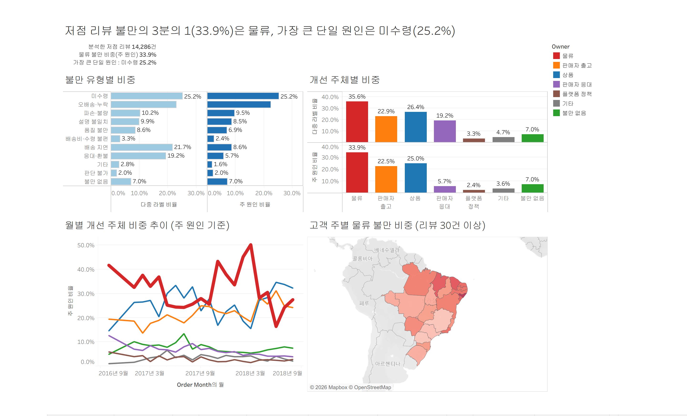
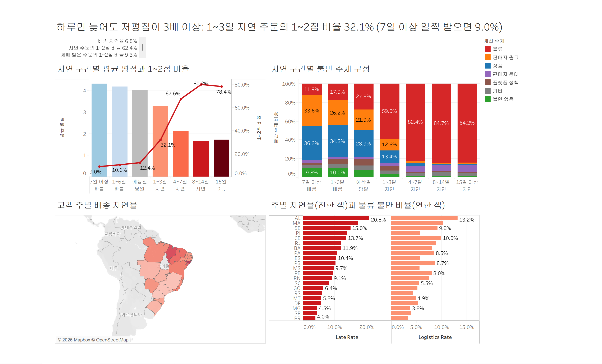
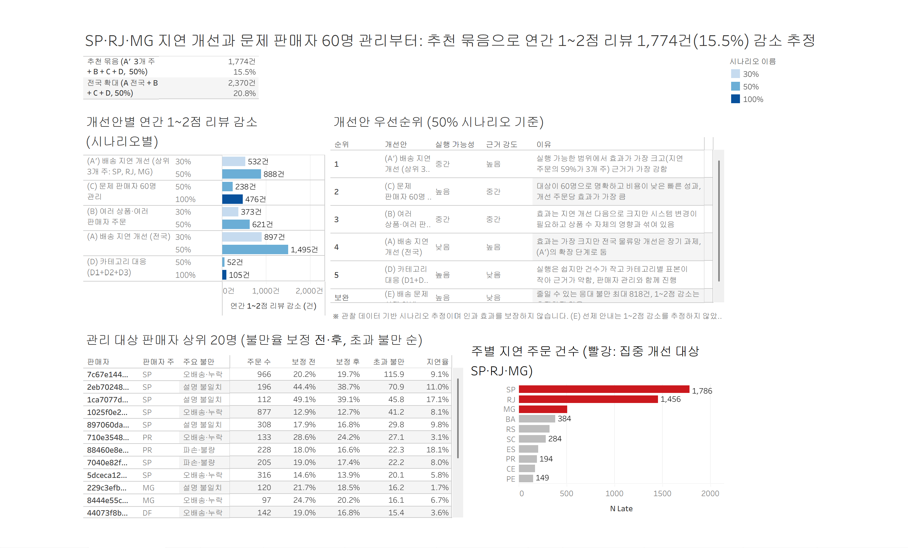
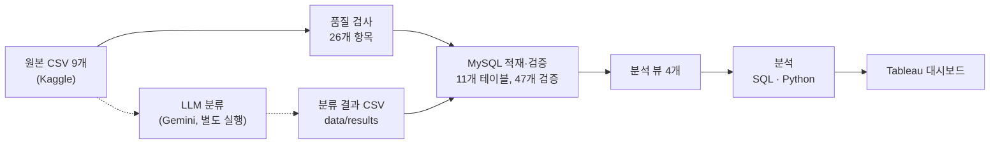

# Olist 리뷰 불만 분석: LLM으로 찾은 불만 원인과 개선 우선순위

브라질 이커머스 Olist의 저점 리뷰를 LLM(Gemini)으로 불만 유형별로 분류하고, 배송·판매자·재구매 데이터와 결합해 개선 우선순위를 정량화한 데이터 분석 프로젝트.

## 핵심 성과

- **LLM 분류 파이프라인 구축**: 텍스트가 있는 1~3점 리뷰 14,286건을 11개 불만 유형으로 분류했다. 사람이 라벨링한 검증 100건에서 라벨 조합 완전 일치율 **0.78**, 주 원인 Cohen's kappa **0.86**(보정 점수 0.81)을 기록했다.
- **재현 가능한 데이터 파이프라인**: 원본 CSV 9개를 품질 검사(26개 항목), MySQL 적재(11개 테이블), 적재 검증(47/47 통과), 분석 뷰(4개)까지 명령 하나(`run_pipeline.py`)로 다시 만든다.
- **불만 원인 정량화**: 저점 리뷰 불만의 **33.9%가 물류**였다. 배송 지연 주문은 다른 요인을 통제해도 1~2점을 받을 오즈가 **17.2배**였다.
- **텍스트로만 보이는 문제 발견**: 판매자가 여러 명인 주문은 1~2점 비율이 **47.4%**(판매자 1명·상품 1개 주문 12.7%)였다. 배송 데이터상 지연율은 1.0%로 가장 낮았지만, 리뷰의 **77%**가 오배송·누락(일부만 받음) 불만이었다.
- **개선 우선순위 제시**: 개선안 5개의 효과를 시나리오로 추정했다. 추천 묶음의 **잠재 효과는 연간 1~2점 리뷰 약 1,774건(15.5%) 감소**다(관찰 데이터 기반 추정).

## 대시보드

Tableau로 만든 대시보드 3개. 통합 문서(데이터 추출 포함)는 [`dashboards/olist_complaint_dashboard.twbx`](dashboards/olist_complaint_dashboard.twbx)이고, Tableau Desktop이나 Tableau Reader로 열 수 있다. 설계와 계산식은 [`dashboards/tableau_spec.md`](dashboards/tableau_spec.md)에 있다.

**① 불만 개요 (Q1)**


**② 배송 지연의 영향 (Q2)**


**③ 개선 우선순위 (Q4·Q5)**


## 문제 정의

오픈마켓에서는 같은 1점 리뷰라도 원인이 배송인지, 판매자인지, 상품인지에 따라 고쳐야 할 주체가 다르다. 그런데 평점만으로는 원인을 알 수 없고, 리뷰 텍스트는 양이 많아 사람이 일일이 읽기 어렵다. 이 프로젝트는 리뷰 텍스트를 LLM으로 구조화해 불만의 원인과 책임 주체를 밝히고, 어떤 개선이 가장 효과적인지 숫자로 비교한다.

| 질문 | 내용 |
|---|---|
| Q1 | 고객 불만의 주요 원인은 무엇인가? |
| Q2 | 배송 지연은 평점과 불만 유형에 얼마나 영향을 주는가? |
| Q3 | 첫 주문 경험이 재구매에 영향을 주는가? |
| Q4 | 불만이 집중되는 판매자·카테고리·지역은 어디인가? |
| Q5 | 어떤 개선 조치가 가장 큰 효과를 낼 것인가? |

## 파이프라인



1. **품질 검사** (`src/etl/quality_check.py`): 날짜 논리, 금액, 결측, 좌표 범위 등 26개 항목을 검사하고 항목마다 처리 방침(변환/표시/집계 제외/그대로 둠)을 정한다 → [`reports/data_quality.md`](reports/data_quality.md)
2. **MySQL 적재·검증** (`src/etl/create_schema.py`, `load.py`, `validate_load.py`): FK·인덱스가 있는 스키마에 적재하고, 행 수·금액 합계·FK 무결성 등을 원본과 대조한다 → [`reports/load_validation.md`](reports/load_validation.md)
3. **분석 뷰** (`sql/views/`): 주문, 대표 리뷰, 고객 주문 순서, 상품·거리 단위 뷰에 품질 플래그를 넣는다.
4. **LLM 분류** (`src/llm/`): Gemini로 리뷰를 분류한다. API 호출이 많고 실행마다 결과가 조금씩 달라질 수 있어 파이프라인과 분리했고, 검증을 마친 결과를 CSV로 고정해 쓴다.
5. **분석** (`sql/analysis/`, `notebooks/`): SQL로 집계하고 Python(scipy, statsmodels)으로 검정·회귀·시뮬레이션을 한다.
6. **Tableau**: `src/analysis/export_tableau.py`로 대시보드용 CSV를 만든다(`data/tableau/`).

## 주요 발견

| 질문 | 결론 | 리포트 |
|---|---|---|
| Q1 불만 원인 | 불만의 33.9%가 물류이고, 가장 큰 단일 원인은 미수령(25.2%, 1점 리뷰에서는 34.6%)이다. 응대 불만은 배송 실패에 덧붙는 2차 불만이다. | [q1_complaint_causes.md](reports/analysis/q1_complaint_causes.md) |
| Q2 배송 지연 | 1~3일만 늦어도 1~2점 비율이 32.1%로, 7일 이상 일찍 받은 주문(9.0%)의 3배가 넘는다. 통제 후 오즈비는 17.2, 저평점 확률은 +25.8%p다. | [q2_delivery_delay.md](reports/analysis/q2_delivery_delay.md) |
| Q3 재구매 | 180일 재구매율은 2.00%로 매우 낮다. 첫 주문 1~2점 고객은 재구매가 0.79배(−0.44%p)로 작지만 확인된 차이가 있다. 첫 주문 지연의 효과는 통계적으로 확인되지 않았다. | [q3_first_order_repurchase.md](reports/analysis/q3_first_order_repurchase.md) |
| Q4 불만 집중 | 베이지안 보정 후 문제 판매자 60명(전체의 2%)이 판매자 통제 가능 불만의 17.1%를 차지한다. 가구는 파손, 침구는 품질 불만이 두드러진다. 여러 판매자 주문은 1~2점 비율이 47.4%다. | [q4_complaint_hotspots.md](reports/analysis/q4_complaint_hotspots.md) |
| Q5 개선 우선순위 | 1순위는 지연 주문의 59%가 몰린 SP·RJ·MG 집중 지연 개선이다(잠재 효과 연 888건). 추천 묶음의 시나리오 추정 효과는 연 1,774건(15.5%)이다. 재구매 증가 효과는 연 10명 안팎으로 미미하다. | [q5_recommendations.md](reports/analysis/q5_recommendations.md) |

## LLM 분류와 검증

평가 리포트는 [`reports/llm_eval/`](reports/llm_eval/)에 있다.

- **분류 체계를 반복 개선했다.** 파일럿 리뷰 100건을 직접 라벨링하며 경계가 애매한 사례를 규칙으로 정리했고, 분류 체계를 v0.1에서 v0.5까지 다듬었다(11개 유형, 우선순위 규칙, 경계 판정 규칙). 체계는 [`src/llm/complaint_taxonomy.md`](src/llm/complaint_taxonomy.md)에 있다.
- **개발 세트 과적합을 검증 세트로 발견했다.** 프롬프트와 후처리를 맞춰 온 파일럿에서는 완전 일치율이 **0.92**였지만, 따로 떼어 둔 검증 100건에서는 **0.78**이었다. 파일럿 점수는 개발 과정에서 부풀려진 값이고, 실제 성능은 검증 점수로 보고한다.
- **후처리는 일반화되지 않았다.** 규칙 기반 후처리는 파일럿에서 완전 일치율을 0.84에서 0.92로 올렸지만, 검증에서는 오히려 0.80에서 0.78로 낮췄다. 검증에서 규칙이 2번 발동해 2번 모두 오답이었다. 개발 데이터에서 만든 규칙이 새 데이터에서는 통하지 않을 수 있음을 기록으로 남겼다.
- **재현성을 확인했다.** 같은 검증 100건을 두 번 분류했을 때 라벨 조합 일치율은 **0.93**, 주 원인 kappa는 0.965였다.
- **운영 데이터와 교차 검증했다.**
  - 리뷰에서 나온 월별 물류 불만 비중과 실제 배송 지연율의 상관이 **0.74**였다.
  - 미수령(NOT_RECEIVED) 라벨이 붙은 리뷰의 **68.6%**가 실제 수령 전에 작성됐다(다른 분류 리뷰는 9.1%).
- **구조화 데이터로는 안 보이던 문제를 찾았다.** 판매자가 여러 명인 주문은 배송 데이터상 지연율이 1.0%로 가장 낮았지만, 리뷰의 77%가 "일부만 받았다"는 오배송·누락 불만이었다. 수령일이 먼저 도착한 상품 기준으로 기록됐을 가능성이 있다(가설).

## 기술 스택

`Python` `pandas` `NumPy` `MySQL 8.0` `SQLAlchemy` `PyMySQL` `Gemini API (google-genai)` `pydantic` `tenacity` `SciPy` `statsmodels` `scikit-learn` `matplotlib` `seaborn` `Jupyter` `Tableau`

## 레포 구조

```text
olist-analysis/
├── run_pipeline.py          # 품질 검사 → 스키마 → 적재 → 뷰 → 검증
├── requirements.txt         # 버전 고정 (Python 3.13)
├── .env.example             # 환경 변수 항목 (복사해서 .env로 사용)
├── CLAUDE.md                # AI(Claude Code) 작업 지침
├── data/
│   ├── raw/                 # Kaggle 원본 CSV (커밋하지 않음, 직접 내려받기)
│   ├── labels/              # 직접 라벨링한 파일럿·검증 리뷰
│   ├── results/             # LLM 분류 결과 CSV (커밋됨)
│   └── tableau/             # 대시보드용 CSV
├── sql/
│   ├── schema/              # 테이블·키·인덱스
│   ├── views/               # 분석 뷰 4개
│   └── analysis/            # Q1~Q5 분석 쿼리
├── src/
│   ├── etl/                 # 품질 검사, 적재, 검증
│   ├── llm/                 # 분류 체계, 프롬프트, 분류·평가·후처리
│   │                        #   (check_api.py, try_prompt.py는 개발 중 API 연결·프롬프트 시험용)
│   └── analysis/            # Tableau 내보내기, 공통 매핑, 판매자 보정 모듈
├── notebooks/               # 01~07 탐색·분석 노트북
├── reports/
│   ├── analysis/            # Q1~Q5 리포트
│   ├── llm_eval/            # LLM 분류 평가 리포트
│   └── figures/             # 차트, 대시보드 이미지
└── dashboards/              # Tableau 통합 문서와 설계서
```

## 재현 방법

필요한 것: Python 3.13, MySQL 8.0. 아래 명령은 Windows(PowerShell) 기준이다. macOS·Linux는 `py -3.13` 대신 `python3.13`, `venv\Scripts\activate` 대신 `source venv/bin/activate`, `copy` 대신 `cp`를 쓴다.

**1. 환경 설정**

```powershell
py -3.13 -m venv venv
venv\Scripts\activate
pip install -r requirements.txt
python -m ipykernel install --user --name olist-venv --display-name "Python (olist-venv)"
```

**2. MySQL DB와 전용 사용자 만들기** (MySQL에 관리자 계정으로 접속해 실행)

```sql
CREATE DATABASE olist CHARACTER SET utf8mb4;
CREATE USER 'olist_user'@'localhost' IDENTIFIED BY '원하는 비밀번호';
GRANT ALL PRIVILEGES ON olist.* TO 'olist_user'@'localhost';
```

**3. 환경 변수 설정**

```powershell
copy .env.example .env
```

`.env`에 아래 항목을 채운다.

```text
MYSQL_HOST=localhost
MYSQL_PORT=3306
MYSQL_USER=olist_user
MYSQL_PASSWORD=원하는 비밀번호
MYSQL_DB=olist
GEMINI_API_KEY=...      # LLM 분류를 다시 돌릴 때만 필요
GEMINI_MODEL=...        # 예: gemini-3.5-flash-lite (LLM 분류를 다시 돌릴 때만 필요)
```

**4. 원본 데이터 넣기**

Kaggle에서 데이터셋을 내려받아 CSV 9개를 `data/raw/`에 넣는다.

**5. 파이프라인 실행**

```bash
python run_pipeline.py --reset   # 테이블을 새로 만들고 품질 검사부터 검증까지 실행
```

**6. LLM 분류 (선택)**

분류 결과 CSV(`data/results/review_complaint_labels.csv`)가 레포에 들어 있어서 **다시 돌리지 않아도 된다.** 다시 분류하려면 아래를 실행한다(Gemini API 키 필요, 리뷰 14,286건에 약 480회 호출).

```bash
python src/llm/classify_reviews.py --input all --run-name full_v2_post3 --max-calls 500
python src/llm/export_labels.py --run-name full_v2_post3
```

**7. 분석 노트북** (커널: Python (olist-venv))

`01_data_overview` → `02_review_exploration` → `03_q1` → `04_q2` → `05_q3` → `06_q4` → `07_q5` 순서로 실행한다. Tableau용 CSV를 다시 만들려면 `07_q5`를 실행한 뒤 `python src/analysis/export_tableau.py`를 실행한다.

## 한계와 다음 단계

- **인과를 단정할 수 없다.** 모든 분석이 관찰 데이터 기반이다. Q2의 오즈비 17.2와 Q5의 효과는 통제하지 못한 요인(판매자 품질, 상품, 가격 등)을 포함할 수 있고, Q5는 시나리오 추정이다.
- **LLM 분류 오차가 있다.** 미수령은 과소 추정됐을 수 있고(검증 재현율 0.67), 응대·환불은 요청만 있어도 붙는 경향이 있으며(정밀도 0.83), 기타는 적게 잡힌다(재현율 0.63).
- **검증 라벨의 규모와 과정에 한계가 있다.** 검증은 100건이라 유형별 지표의 불확실성이 크다. 검증 라벨 100건은 작성자 한 명이 라벨링했고, 다른 라벨러와의 일치도는 측정하지 않았다. 판단이 어려웠던 23건은 라벨링 중 AI와 상의하며 판정 기준을 정했다. 이 23건을 빼고 평가해도 완전 일치율 0.83, 주 원인 kappa 0.92로 점수가 낮아지지 않아([validation_run1_excl23.md](reports/llm_eval/validation_run1_excl23.md)), 상의 과정이 점수를 부풀리지는 않은 것으로 판단했다. 검증 중 규칙과 어긋난 정답 3건도 발견됐다(보정 점수 0.81은 LLM과 불일치한 건만 재검토한 낙관적 값).
- **여러 판매자 주문의 지연은 과소 추정됐을 수 있다.** 수령일이 먼저 도착한 상품 기준으로 기록됐을 가능성이 있다(가설).
- **관리 대상 판매자를 비율 기준으로만 골랐다.** 그래서 주문이 많아 초과 불만 건수가 큰 판매자를 놓칠 수 있다(예: 초과 불만 68.0건인데 제외된 판매자). 다음 단계로 초과 불만 건수 기준을 함께 쓰는 방안을 검토한다.
- **선제 안내 효과는 추정하지 않았다.** 배송 문제가 생겼을 때 먼저 알리는 조치(응대 불만 최대 818건 대상)는 A/B 테스트로 효과를 확인해야 한다.

## AI 협업 방식

- 코드 작성과 반복 작업은 Claude Code와 함께 진행했고, 작업 지침은 [`CLAUDE.md`](CLAUDE.md)에 정리했다.
- 분석 질문 설계, 분류 체계 판정 기준, 검증 정답 라벨링, 결과 해석과 의사결정은 작성자가 담당했다.
- AI가 만든 결과는 사람이 만든 정답지, 운영 데이터와의 교차 검증, 출처 대조로 확인했다.

## 데이터 출처

- [Brazilian E-Commerce Public Dataset by Olist](https://www.kaggle.com/datasets/olistbr/brazilian-ecommerce) (Kaggle)
- 라이선스: **CC BY-NC-SA 4.0** (저작자 표시-비영리-동일조건 변경허락). 원본 데이터는 레포에 포함하지 않는다.
- 레포에 포함된 가공 데이터(`data/results/`, `data/tableau/`, `data/labels/`)도 원본과 같은 CC BY-NC-SA 4.0 라이선스를 따른다.
