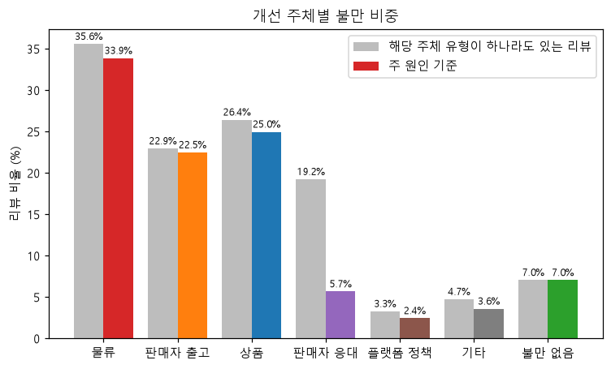
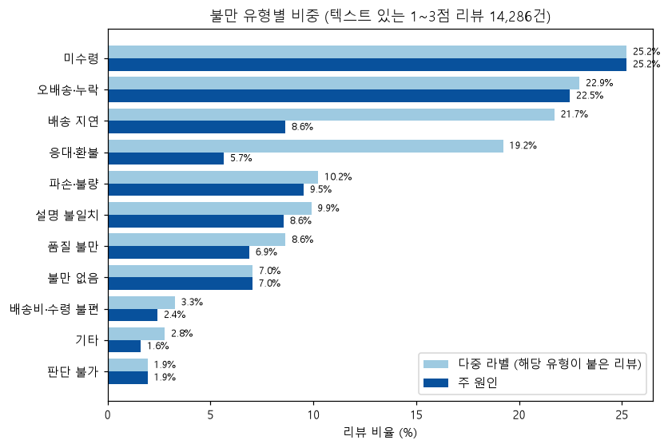
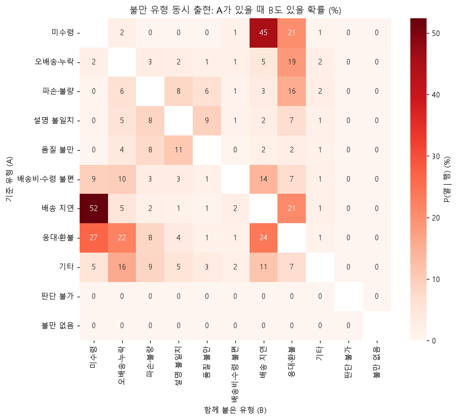
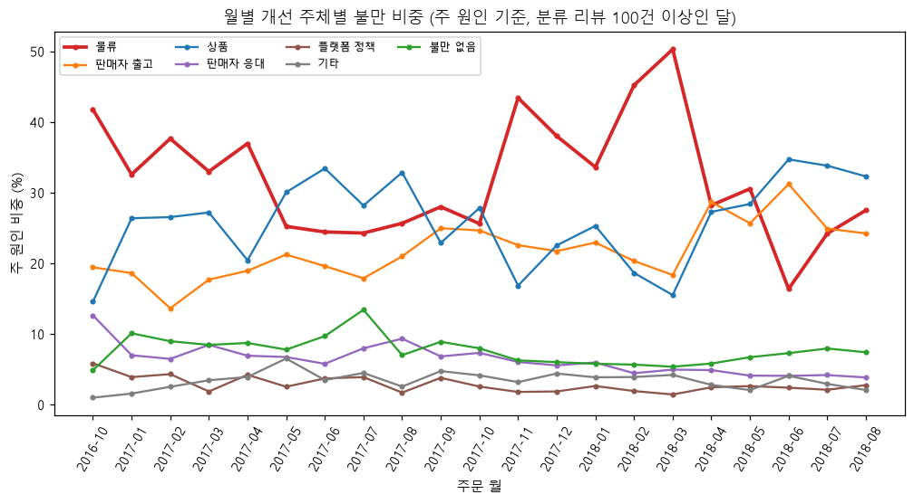

# Q1. 고객 불만의 주요 원인

- 데이터: 텍스트가 있는 1~3점 리뷰 14,286건의 LLM 불만 분류 결과(MySQL `review_complaint_labels`) + 주문·배송 데이터
- 쿼리: `sql/analysis/q1_01` ~ `q1_08` / 노트북: `notebooks/03_q1_complaint_causes.ipynb` / 차트: `reports/figures/q1_*.png`
- 기준: **주 원인**은 리뷰당 1개(우선순위로 선택, 합 100%), **다중 라벨**은 해당 유형이 붙은 리뷰 비율(합이 100%를 넘음)

## 핵심 발견

### 1. 불만의 3분의 1은 물류에서 나온다. 가장 큰 단일 원인은 "아예 못 받음"

| 개선 주체 | 주 원인 비중 | 다중 라벨 비중 |
|---|---|---|
| **물류** (미수령·배송 지연) | **33.9%** | 35.6% |
| 상품 (파손·설명 불일치·품질) | 25.0% | 26.4% |
| 판매자 출고 (오배송·누락) | 22.5% | 22.9% |
| 판매자 응대 (응대·환불) | 5.7% | 19.2% |
| 플랫폼 정책 (배송비·수령 불편) | 2.4% | 3.3% |
| 기타·판단 불가 | 3.6% | 4.7% |
| 불만 없음 | 7.0% | 7.0% |

- 유형 하나로는 **미수령이 25.2%로 가장 많고**, 1점 리뷰에서는 34.6%에 이른다.
- 주문 상태로 결제 후 품절·취소 주문을 보완하면 미수령은 **27.9%**, 물류는 **36.0%**로 더 커진다(아래 6번).

### 2. 점수에 따라 불만의 성격이 다르다: 1점은 "안 왔다", 3점은 "왔는데 아쉽다"

| 유형 (주 원인) | 1점 (8,640건) | 2점 (2,118건) | 3점 (3,528건) |
|---|---|---|---|
| 미수령 | **34.6%** | 15.9% | 7.8% |
| 오배송·누락 | 24.6% | 25.0% | 15.8% |
| 품질 불만 | 4.2% | 9.8% | **11.7%** |
| 불만 없음 | 1.2% | 4.7% | **22.7%** |

- 1점은 배송 실패(미수령)가 지배한다. 3점은 품질 불만과 불만 없는 리뷰의 비중이 커진다.
- **오배송·누락은 1·2점에서 모두 약 25%로 꾸준하다.** 판매자가 직접 통제할 수 있는 출고 단계의 문제가 저점 리뷰 4건 중 1건의 주 원인이다.

### 3. 응대 불만은 혼자 오지 않는다: 다른 실패에 덧붙는 "2차 불만"

- 응대·환불은 다중 라벨로는 19.2%지만 주 원인으로는 5.7%다. 1점 리뷰에서는 다중 라벨 26.0%로, 미수령 다음으로 많다.
- 응대·환불이 붙은 리뷰 중 **27%는 미수령, 24%는 배송 지연, 22%는 오배송·누락**과 함께 나타난다.
- 고객은 배송·출고에 실패한 뒤 판매자의 안내 부재나 무응답을 겪을 때 불만을 키운다. 개선 효과가 큰 지점은 응대 자체보다 **배송 문제가 생겼을 때의 선제 안내**일 가능성이 높다.
- 배송 지연이 붙은 리뷰의 52%는 미수령과 함께 나타난다. 반대로 오배송·누락과 배송 지연은 함께 나타나는 일이 드물다(lift 0.21). 서로 다른 실패 경로로 보인다.

### 4. 물류 불만 비중은 실제 배송 지연율과 같은 달에 함께 움직인다 (월별 상관 0.74)

| 주문 월 | 물류 불만 비중 (주 원인) | 실제 지연율 |
|---|---|---|
| 2017-11 (블랙프라이데이) | 43.4% | 12.4% |
| 2018-02 | 45.2% | 14.1% |
| 2018-03 | **50.3%** | **19.0%** |
| 2018-06 | 16.4% | 1.2% |

- 분류 리뷰가 100건 이상인 21개월 기준으로, 리뷰 텍스트에서 나온 물류 불만 비중과 `v_orders`의 실제 지연율의 상관계수는 0.74다.
- 텍스트 분류 결과가 실제 운영 데이터와 같은 방향으로 움직인다는 점에서 **LLM 분류의 외부 타당성을 보여 주는 근거**이기도 하다.
- 물류 불만은 주문이 몰리는 시기(2017-11)와 2018년 2~3월에 집중된다. 배송 지연과 평점의 관계는 Q2에서 검정한다.

## 결제 후 품절·취소 보완 전후

LLM은 분류 체계 규칙 P(결제 후 품절 통보 → SERVICE)에 따라 품절 주문 리뷰를 응대 불만으로만 분류하는 경향이 있다(검증에서 확인된 미수령 누락의 주요 원인).

| 대표 주문 상태 | 분류 리뷰 | NOT_RECEIVED 부여율 | NOT_RECEIVED가 없을 때 주 원인 1위 |
|---|---|---|---|
| unavailable (결제 후 품절) | 387 | 47.8% | 응대·환불 62% |
| canceled | 345 | 45.8% | 응대·환불 57% |
| 그 외 | 13,554 | 24.1% | - |

보완 규칙: 대표 주문 상태가 unavailable·canceled이고 "불만 없음"이 아닌 리뷰는 미수령으로 간주한다.

| 지표 | 보완 전 | 보완 후 (unavailable+canceled) | 보완 후 (unavailable만) |
|---|---|---|---|
| 미수령 (다중 라벨 = 주 원인) | 25.2% | **27.9%** (+380건) | 26.6% (+198건) |
| 물류 다중 라벨 | 35.6% | 37.7% | 36.7% |
| 물류 주 원인 | 33.9% | **36.0%** | 35.0% |

- 보완해도 순위와 결론(물류가 1위 원인)은 그대로이고, 물류 비중이 1~2%p 커진다.
- canceled에는 고객이 직접 취소한 주문이 섞여 있을 수 있어서, **보수적으로는 unavailable만 보완한 값(물류 35.0%)**을 쓴다.

## 해석할 때 주의할 점

- **분석 대상의 범위**: 텍스트가 있는 1~3점 리뷰 14,286건만 대상이다. 전체 리뷰 99,224건의 14.4%다. 4~5점 리뷰와 텍스트 없는 리뷰는 포함하지 않으므로, 결과는 "전체 고객의 불만 비율"이 아니라 **"불만을 글로 남긴 저점 리뷰의 구성"**이다.
- **분류 정확도**: 검증 100건 기준 라벨 조합 완전 일치율 **0.78(공식)**, micro F1 0.89, 주 원인 kappa 0.86, 같은 입력을 두 번 실행했을 때 일치율 0.93이다. 규칙과 어긋난 정답 3건을 바로잡은 보정 점수는 완전 일치율 0.81이지만, 이 값은 낙관적이다.
- **유형별로 알려진 한계**
  - 미수령은 과소 추정됐을 수 있다(검증 재현율 0.67). 결제 후 품절을 응대 불만으로만 분류하는 경향 때문이며, 위의 보완 전후 비교로 영향 범위(+1.4~2.7%p)를 확인했다.
  - 기타는 재현율 0.63으로 적게 잡혔을 수 있다.
  - 응대·환불은 교환·환불을 요청만 한 경우에도 붙는 경향이 있다(검증 정밀도 0.83). 다중 라벨 19.2%는 다소 과대일 수 있다.
  - 배송 지연은 후처리 규칙이 판매자 응답 대기를 지연으로 잘못 인식하는 경우가 있다(전체의 0.15% 이하로 추정).
- **주문 연결 기준**: 한 리뷰가 여러 주문에 연결된 153건(1.1%)은 구매 시각이 가장 이른 주문을 대표 주문으로 썼다(월·주문 상태 기준).
- **월별 비교**: 2016-09, 2018-09, 2018-10은 분류 리뷰가 100건 미만이라 추이에서 뺐다. 월별 상관(0.74)은 21개 점으로 계산한 집계 수준의 관계이고, 개별 주문 단위의 인과를 뜻하지 않는다.
