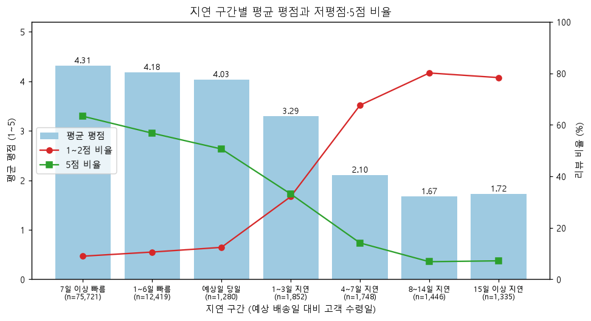
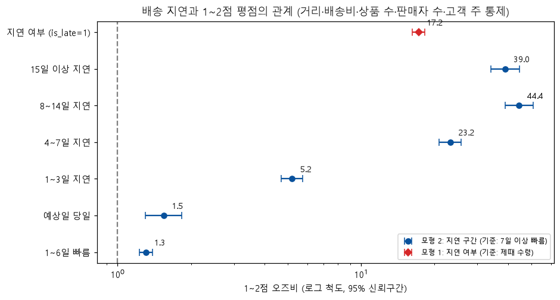
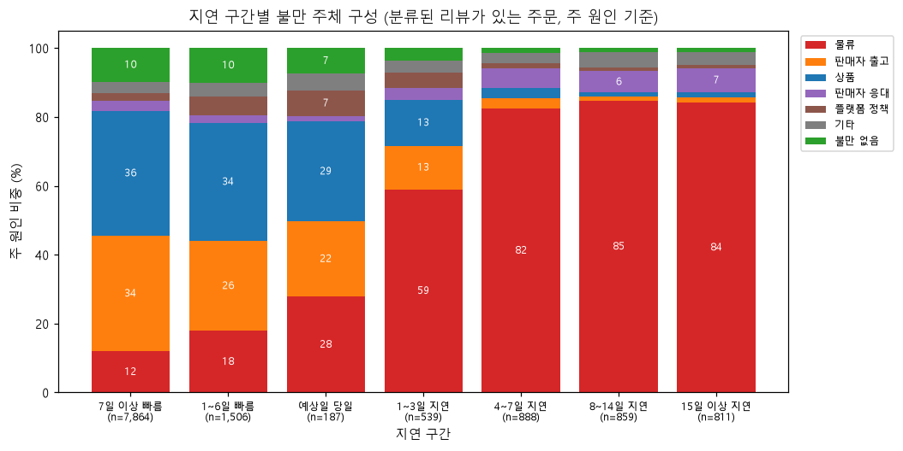
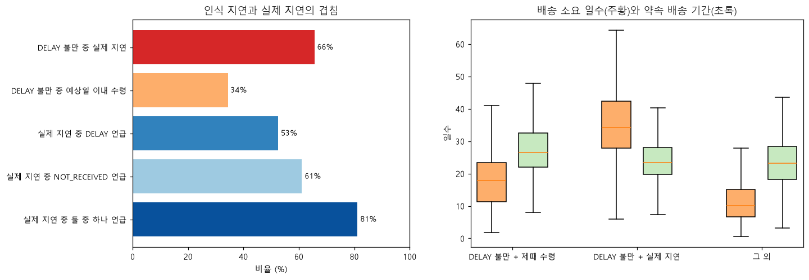

# Q2. 배송 지연이 평점과 불만 유형에 미치는 영향

- 단위: 주문. 배송 지표 대상 주문 96,447건(`v_orders`, `exclude_delivery_metrics = 0`: delivered이고 날짜가 정상인 주문), 평점은 주문당 대표 리뷰(`v_order_reviews`)
- 지연: 예상 배송일 대비 고객 수령일(날짜 단위). `is_late` = 예상일보다 하루라도 늦게 받음
- 쿼리: `sql/analysis/q2_01` ~ `q2_08` / 노트북: `notebooks/04_q2_delivery_delay.ipynb` / 차트: `reports/figures/q2_*.png`

## 핵심 발견

### 1. 지연과 낮은 평점이 강하게 연관된다: 1~3일만 늦어도 1~2점 비율이 제때 받은 주문의 3배 이상(32.1% vs 9.3%)

| 지연 구간 | 리뷰 있는 주문 | 평균 평점 | 1~2점 비율 | 5점 비율 |
|---|---|---|---|---|
| 7일 이상 빠름 | 75,721 | 4.31 | 9.0% | 63.4% |
| 1~6일 빠름 | 12,419 | 4.18 | 10.6% | 56.8% |
| 예상일 당일 | 1,280 | 4.03 | 12.4% | 50.6% |
| 1~3일 지연 | 1,852 | 3.29 | **32.1%** | 33.2% |
| 4~7일 지연 | 1,748 | 2.10 | **67.6%** | 14.1% |
| 8~14일 지연 | 1,446 | 1.67 | **80.2%** | 6.8% |
| 15일 이상 지연 | 1,335 | 1.72 | 78.4% | 7.2% |

- 평점은 예상일을 넘기는 순간 급격히 떨어지고, 8일 이상 늦으면 더 떨어지지 않고 바닥에 머문다(평균 1.7점, 저평점 약 80%).
- **예상일보다 일찍 와도 일찍 올수록 평점이 높다.** 예상일 당일 수령(4.03)은 7일 이상 일찍 받은 주문(4.31)보다 낮다. "약속을 지켰는지"뿐 아니라 "얼마나 빨리 왔는지"도 평점과 연관된 것으로 보인다.
- 배송 지표 대상 주문의 79%가 예상일보다 7일 이상 일찍 도착한다. 예상 배송일이 넉넉하게 잡혀 있어서, 실제 지연은 전체의 6.8%다.

### 2. 다른 요인을 통제해도 지연과의 연관은 압도적이다 (오즈비 17, 저평점 확률 +26%p)

거리, 배송비, 상품 수, 판매자 수, 고객 주를 통제한 로지스틱 회귀(95,325건)에서도 지연된 주문이 1~2점을 받을 오즈는 **17.2배**(95% CI 16.2~18.2)다. 다른 조건이 같을 때 지연된 주문은 1~2점 확률이 평균 **+25.8%p** 높았다(평균 한계효과). 지연 구간별로 보면 오즈비가 단계적으로 커진다.

| 지연 구간 (기준: 7일 이상 빠름) | 1~2점 오즈비 | 95% CI |
|---|---|---|
| 1~6일 빠름 | 1.31 | 1.23~1.39 |
| 예상일 당일 | 1.54 | 1.30~1.83 |
| 1~3일 지연 | 5.20 | 4.69~5.76 |
| 4~7일 지연 | 23.2 | 20.9~25.7 |
| 8~14일 지연 | **44.4** | 38.9~50.8 |
| 15일 이상 지연 | 39.0 | 34.1~44.7 |

### 3. 늦을수록 불만의 내용이 "물류" 하나로 수렴한다

분류된 리뷰(텍스트 있는 1~3점)가 있는 주문의 주 원인 구성:

| 지연 구간 | 물류 | 상품 | 판매자 출고 | DELAY 언급 | NOT_RECEIVED 언급 |
|---|---|---|---|---|---|
| 7일 이상 빠름 (7,864건) | 12% | **36%** | **34%** | 7% | 8% |
| 예상일 당일 (187건) | 28% | 29% | 22% | 25% | 10% |
| 1~3일 지연 (539건) | **59%** | 13% | 13% | 48% | 38% |
| 4~7일 지연 (888건) | **82%** | 3% | 3% | 54% | 64% |
| 15일 이상 지연 (811건) | **84%** | 2% | 1% | 53% | 67% |

- 일찍 도착한 주문의 불만은 상품(36%)과 판매자 출고(34%)가 대부분이다. 4일 이상 늦으면 불만의 80% 이상이 물류다.
- 지연 주문의 리뷰에는 DELAY보다 **NOT_RECEIVED가 더 많다(64~67%).** 리뷰를 쓴 시점에 아직 못 받은 고객이 많다는 뜻으로, 지연이 길수록 "늦음"보다 "안 옴"으로 쓴 리뷰가 많았다.

### 4. 배송 지연 불만의 3분의 1은 "약속은 지켰지만 너무 오래 걸린" 주문이다

- DELAY 불만이 붙은 주문 2,481건 중 **65.6%는 실제로 지연**됐고, **34.4%는 예상일 이내에 받았다.**
- 제때 받았는데 DELAY 불만을 쓴 주문은 약속 배송 기간 자체가 길었다(중앙값 26.6일, 그 외 주문 23.2일). 실제 배송에도 오래 걸렸다(중앙값 17.8일, 그 외 주문 10.1일).
- 즉 **약속한 날짜를 지켜도 배송 기간이 길면 불만이 함께 나타났다.** 예상 배송일을 보수적으로 늘리는 것만으로는 배송 불만을 줄이기 어려울 수 있다.
- 반대로 실제로 지연된 주문 3,097건 중 리뷰에서 DELAY를 언급한 비율은 52.6%, DELAY나 NOT_RECEIVED 중 하나라도 언급한 비율은 81.2%다.

### 5. 판매자가 여러 명인 주문도 지연과 별개로 저평점 위험이 크다

회귀 모형에서 판매자 수가 1명 늘 때 1~2점 오즈비는 **4.64**(95% CI 4.12~5.24), 상품 수가 1개 늘 때는 1.57이다. 지연·거리·배송비를 통제한 뒤의 값이다. 판매자가 여러 명인 주문은 여러 번 나눠 배송되므로, 일부만 먼저 받은 고객이 불만을 남기는 것으로 보인다(Q1의 오배송·누락 중 분할 배송). 이는 Q4·Q5에서 더 확인할 가설이다.

## 지연 요인 (Q5 개선안 참고)

- **거리**: 판매자 → 고객 직선 거리가 멀수록 지연율이 높다. 100km 미만 4.5%, 300~600km 6.8%, 1,000~2,000km 9.5%, 2,000km 이상 12.0%.
- **지역** (주문 300건 이상인 주): 지연율이 가장 높은 곳은 AL 21.4%, MA 17.4%, SE 15.2%이고, 가장 낮은 곳은 SP 4.5%, PR 4.0%다.
  - 북동부 주는 약속 배송 기간이 30일 이상으로 이미 긴데도 지연율이 높다.
  - **RJ는 주문 1만 2천 건 규모인데 지연율이 12.1%**로, 지연 주문의 절대 수가 가장 큰 개선 대상이다.

## 통계 검정 요약

표본이 약 9만 6천 건이라 모든 검정의 p값이 0에 가깝다. 아래는 효과의 크기를 중심으로 정리했다.

| 분석 | 결과 | 효과 크기 해석 |
|---|---|---|
| 평점 분포 비교 (Mann-Whitney U) | 지연 6,381건 평균 2.27(중앙값 1) vs 제때 89,420건 평균 4.29(중앙값 5) | rank-biserial r = **−0.64** (큰 효과). 무작위로 고른 지연 주문의 평점이 제때 받은 주문보다 높을 확률은 **18%** |
| 1~2점 비율 차이 (두 비율 z 검정) | 62.4% vs 9.3%, 차이 **+53.1%p** (95% CI +51.9~+54.3%p) | 위험비 **6.74배** (95% CI 6.55~6.93) |
| 로지스틱 회귀 모형 1 | is_late 오즈비 **17.2** (16.2~18.2), 평균 한계효과 +25.8%p | 통제변수를 넣어도 연관이 크게 남음. McFadden 의사 R² 0.16 |
| 로지스틱 회귀 모형 2 | 1~3일 지연 5.2 → 4~7일 23.2 → 8~14일 44.4 | 지연 일수에 따라 단계적으로 커지다가 8일 이상에서 포화 |
| NOT_RECEIVED 라벨 교차 검증 | NOT_RECEIVED 리뷰의 **68.6%**가 실제 수령 전에 작성됨(비교 기준: 다른 분류 리뷰 9.1%) | 미수령 라벨이 실제 배송 상태와 맞는다는 근거 |

## 해석할 때 주의할 점

- **관찰 데이터라 인과로 단정할 수 없다.** 회귀로 거리·배송비·상품 수·판매자 수·고객 주를 통제했지만, 통제하지 못한 요인이 남아 있다.
  - 상품 카테고리와 가격, 판매자 품질, 고객의 기대 수준과 과거 경험
  - 지연이 잦은 판매자는 다른 품질 문제도 많을 수 있어서, 오즈비 17에는 이런 요인이 일부 섞여 있을 수 있다.
- **리뷰가 있는 주문만 분석했다.** 평점 분석은 배송 지표 대상 주문 중 리뷰가 있는 95,801건(99.3%) 기준이다. 불만 구성 분석은 텍스트가 있는 1~3점 리뷰가 있는 주문(약 1만 3천 건)만 대상이라, 불만 비중은 "글로 불만을 남긴 주문의 구성"이다.
- **리뷰를 쓴 시점과 배송 시점이 다르다.** 지연 주문의 상당수는 수령 전에 리뷰가 작성됐다(NOT_RECEIVED 리뷰의 69%). 이 경우 평점은 "늦게 받음"보다 "아직 못 받음"에 대한 반응이다.
- **예상 배송일이 기준이다.** 지연은 Olist가 고객에게 안내한 예상일 기준이고, 예상일이 넉넉하게 잡혀 있어서 "지연"은 상당히 늦은 경우만 잡힌다. 제때 받았는데도 배송 불만을 남긴 주문이 34%라는 점이 이를 보여 준다.
- **여러 판매자 주문의 지연은 배송 데이터에서 적게 잡혔을 수 있다.** 판매자가 여러 명인 주문은 기록상 지연율이 1.0%로 가장 낮았지만, 분류된 리뷰의 77%가 오배송·누락 불만이었다(Q4). 수령일이 먼저 도착한 상품 기준으로 기록됐을 가능성이 있어(가설), 이런 주문의 지연은 실제보다 적게 잡혔을 수 있다. 다만 이런 주문은 배송 지표 대상 주문의 약 1.3%(1,256건)라 이 리포트의 핵심 결론은 바뀌지 않는다.
- **모형의 한계**
  - 같은 판매자나 같은 고객의 주문끼리 비슷할 수 있는 점(군집 효과)을 반영하지 않아 신뢰구간이 실제보다 좁을 수 있다.
  - 거리는 우편번호 평균 좌표로 계산한 직선 거리이고, 거리를 계산할 수 없는 476건은 회귀에서 뺐다.
  - 대표 리뷰 기준이라 리뷰가 여러 개인 547개 주문은 1개 리뷰만 반영했다.
- **불만 유형은 LLM 분류 결과다.** 검증 정확도(완전 일치율 0.78)와 유형별 한계(미수령 과소, 응대 과다 부여 등)는 Q1 리포트를 참고한다.
