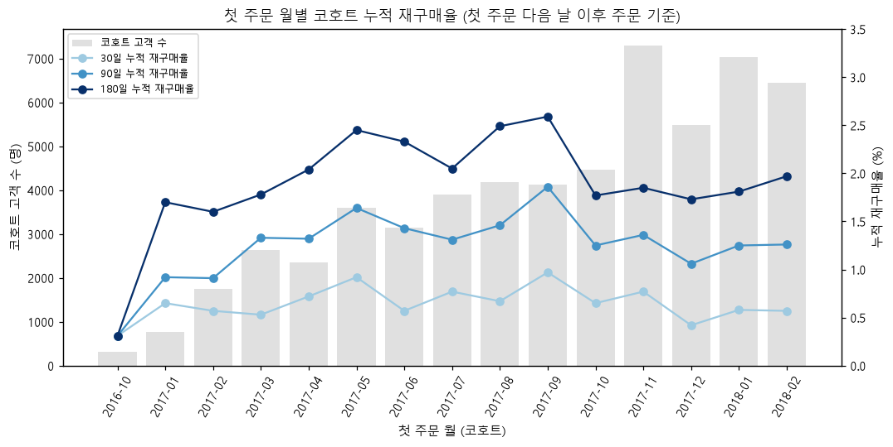
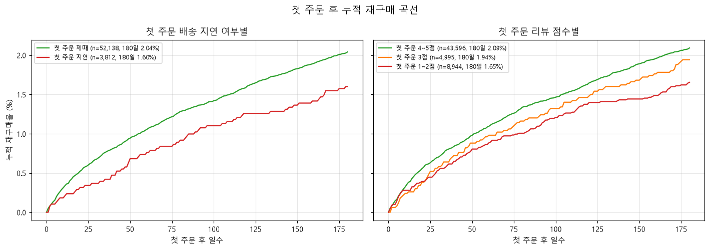
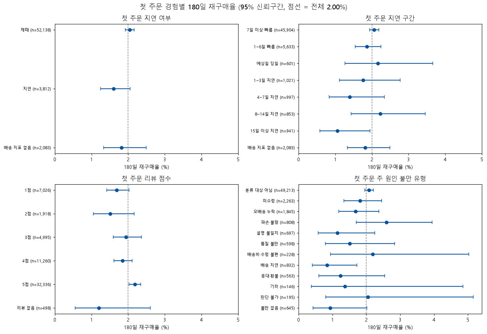
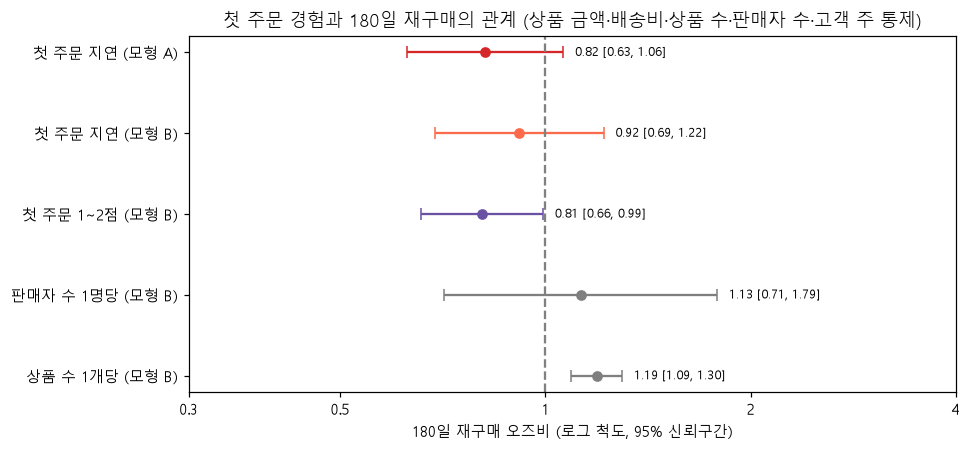

# Q3. 첫 주문 경험이 재구매에 영향을 주는가?

- 단위: 고객(`customer_unique_id`). 첫 주문 = 구매 시각이 가장 이른 주문
- 재구매: 첫 주문 **다음 날 이후**(구매 날짜 기준 1일 이상 뒤)의 주문. 같은 날 추가 주문은 제외한다.
- 결과 변수: 첫 주문 후 **180일 안에** 재구매했는지
- 쿼리: `sql/analysis/q3_01` ~ `q3_04` / 노트북: `notebooks/05_q3_first_order_repurchase.ipynb` / 차트: `reports/figures/q3_*.png`

## 관찰 기간 설정

| 기준 | 관찰 종료일 | 첫 주문일 상한 | 분석 대상 | 제외 | 180일 재구매율 |
|---|---|---|---|---|---|
| **실제 수집 종료일 (분석 기준)** | 2018-08-29 | 2018-03-02 | **58,033명** | 38,063명 | **2.00%** |
| 데이터 마지막 주문일 (민감도 확인) | 2018-10-17 | 2018-04-20 | 68,988명 | 27,108명 | 1.94% |

- **방법**: 첫 주문일 + 180일 ≤ 관찰 종료일인 고객만 분석한다. 모든 고객의 관찰 기간을 똑같이 180일로 맞추기 위해서다. 최근 고객일수록 재구매할 시간이 짧아 재구매율이 낮게 나오는 문제(우측 절단)를 막는다.
- **관찰 종료일을 2018-08-29로 정한 이유**
  - 데이터의 마지막 주문일은 2018-10-17이지만, 2018-08-29 이후에는 주문이 사실상 없다(9~10월 두 달간 20건, 배송 완료 0건).
  - 마지막 주문일을 기준으로 하면 2018년 3~4월 첫 주문 고객은 180일 중 마지막 1~2개월에 재구매를 관찰할 수 없다.
  - 그래서 하루 주문이 10건 이상인 마지막 날을 관찰 종료일로 썼다.
- **민감도**: 두 기준의 재구매율 차이는 0.06%p로 작아서, 이 선택이 결론을 바꾸지 않는다.

## 핵심 발견

### 1. 재구매 자체가 매우 드물다: 180일 안에 다시 산 고객은 50명 중 1명

- 180일 누적 재구매율은 30일 0.66%, 90일 1.33%, **180일 2.00%**다. 전체 고객 96,096명 중 관찰 기간과 관계없이 한 번이라도 재구매한 고객도 2.24%뿐이다.
- 첫 주문 월별 코호트로 보면 2017년 5~9월 코호트가 2.3~2.6%로 가장 높고, 2017년 10월~2018년 2월 코호트는 1.7~2.0%로 낮다.
- Olist 고객 대부분에게 첫 주문은 사실상 유일한 주문이다. 그래서 첫 주문 경험이 재구매에 미치는 영향도 **절대 규모로는 작을 수밖에 없다.**

### 2. 첫 주문에 1~2점을 준 고객은 재구매가 약 20% 적다 (효과는 작지만 통계적으로 확인됨)

| 비교 | 180일 재구매율 | 차이 (%p) | 상대 비율 |
|---|---|---|---|
| 첫 주문 1~2점 (8,944명) vs 4~5점 (43,596명) | 1.65% vs 2.09% | **−0.44%p** (95% CI −0.72 ~ −0.12) | **0.79배** (0.67 ~ 0.94) |

- 로지스틱 회귀(모형 B: 지연 여부, 상품 금액, 배송비, 상품 수, 판매자 수, 고객 주 통제)에서 첫 주문 1~2점의 오즈비는 **0.81**(0.66~0.99)이다. 평균 한계효과는 **−0.42%p**다.
- 절대 규모로 보면 저평점 첫 주문 1만 건당 재구매 고객이 약 44명 적다는 뜻이다. 비율로는 의미 있지만 재구매 기저율이 낮아 절대 차이는 작다.

### 3. 첫 주문 지연과 재구매의 관계는 방향은 음(−)이지만 통계적으로 확인되지 않는다

| 비교 | 180일 재구매율 | 차이 (%p) | 상대 비율 |
|---|---|---|---|
| 첫 주문 지연 (3,812명) vs 제때 (52,138명) | 1.60% vs 2.04% | −0.44%p (95% CI −0.81 ~ **+0.02**) | 0.78배 (0.61 ~ **1.01**), p = 0.06 |

- 지연된 첫 주문 고객 중 재구매는 61명뿐이라 신뢰구간이 넓고 0(상대 비율은 1)을 포함한다.
- 로지스틱 회귀에서도 지연의 오즈비는 **0.82**(0.63~1.06, 모형 A)로 1을 포함한다.
- 저평점 변수를 함께 넣으면(모형 B) 지연의 오즈비는 **0.92**(0.69~1.22)로 1에 더 가까워진다. Q2에서 지연이 저평점의 가장 강한 원인이었다는 점과 함께 보면, **지연이 재구매에 미치는 영향이 있다면 대부분 "지연 → 낮은 평가(불만족) → 재구매 감소" 경로로 나타날 가능성**이 있다. 다만 이것도 관찰 데이터에서 본 패턴일 뿐 인과 경로를 검증한 것은 아니다.
- 누적 재구매 곡선에서는 첫 주문 후 2~3주부터 지연 고객의 곡선이 아래에 있고 그 차이가 180일까지 유지된다.

### 4. 첫 주문 경험은 재구매를 거의 설명하지 못한다

- 회귀 모형의 McFadden 의사 R²는 **0.004~0.005**다. 첫 주문의 배송·평점·금액·상품 수·지역을 모두 넣어도 누가 재구매할지 거의 설명하지 못한다. 재구매는 상품의 성격(소모품인지, 한 번 사면 끝나는 물건인지), 고객의 필요, 다른 쇼핑 채널 같은 이 데이터 밖의 요인에 더 크게 좌우되는 것으로 보인다.
- 통제변수 중 첫 주문 상품 수는 1개당 오즈비 **1.19**(1.09~1.30)로 재구매와 양(+)의 관계다. 여러 상품을 함께 산 고객이 다시 살 가능성이 높다.
- 불만 유형별로는 배송 지연(0.84%, 832명), 불만 없음(0.93%), 설명 불일치(1.15%)가 낮고 파손·불량(2.60%)이 높다. 하지만 그룹당 재구매가 수 명~수십 명이라 신뢰구간이 겹쳐서 **유형 간 순위를 매길 수는 없다.**

## 통계 검정 요약

| 분석 | 결과 | 해석 |
|---|---|---|
| 1~2점 vs 4~5점 (두 비율 z 검정) | −0.44%p (CI −0.72 ~ −0.12), 0.79배, p = 0.007 | 작지만 확인된 차이 |
| 지연 vs 제때 (두 비율 z 검정) | −0.44%p (CI −0.81 ~ +0.02), 0.78배, p = 0.06 | 방향은 같지만 확인되지 않음 |
| 로지스틱 회귀 모형 A (n = 55,533) | 지연 오즈비 0.82 (0.63 ~ 1.06), AME −0.40%p | 확인되지 않음 |
| 로지스틱 회귀 모형 B | 지연 0.92 (0.69 ~ 1.22) / 1~2점 **0.81** (0.66 ~ 0.99), AME −0.42%p | 저평점만 확인됨 |

재구매율이 2% 안팎이라 오즈비는 재구매율의 상대 비율과 거의 같게 읽어도 된다.

## 해석할 때 주의할 점

- **관찰 데이터라 인과로 단정할 수 없다.** 저평점과 재구매 감소가 함께 나타나는 것은 "나쁜 경험이 재구매를 줄였다"일 수도 있지만, "원래 재구매 가능성이 낮은 상품·고객이 낮은 평점을 주는 경향"일 수도 있다.
- **재구매 기저율이 낮다.** 재구매는 분석 대상 58,033명 중 1,163명뿐이고, 지연 첫 주문 고객 중에서는 61명이다. 그래서 그룹 간 차이를 검출할 힘(검정력)이 약하다. 지연 효과가 "없다"는 뜻이 아니라 "이 데이터로는 확인할 수 없다"는 뜻이다.
- **통제하지 못한 요인**
  - 상품 카테고리: 재구매 주기가 다르다(예: 가구 vs 소모품).
  - 가격대와 할인, 마케팅 노출
  - 고객의 다른 채널 구매: Olist는 여러 마켓플레이스에 판매하는 판매자를 모은 구조라 같은 고객이 다른 경로로 재구매했을 수 있다.
  - 고객 식별: `customer_unique_id`가 다른 이메일·계정을 쓴 같은 사람을 놓칠 수 있다.
- **변수 정의**
  - 지연 여부는 첫 주문이 배송 지표 대상(delivered이고 날짜가 정상)인 경우만 정의했다. 미배송·취소된 첫 주문(2,083명)은 "배송 지표 없음"으로 따로 집계했다.
  - 평점은 첫 주문의 대표 리뷰 기준이다.
  - 재구매에는 이후 취소된 주문도 포함된다(주문을 시도한 것 자체를 재구매 의사로 봄).
- **관찰 종료일은 판단으로 정했다.** "하루 주문 10건 이상인 마지막 날"이라는 규칙으로 정했고, 데이터 마지막 주문일 기준과 비교해 결론이 같음을 확인했다(2.00% vs 1.94%).
