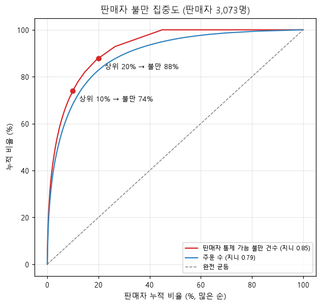
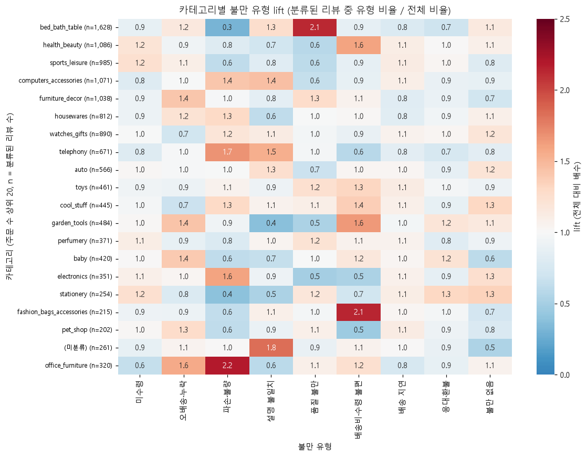
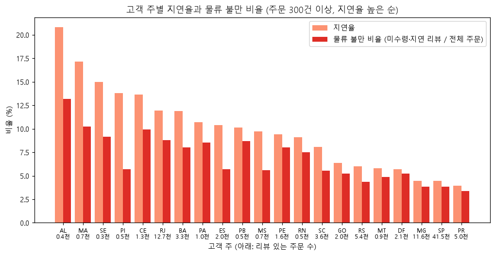
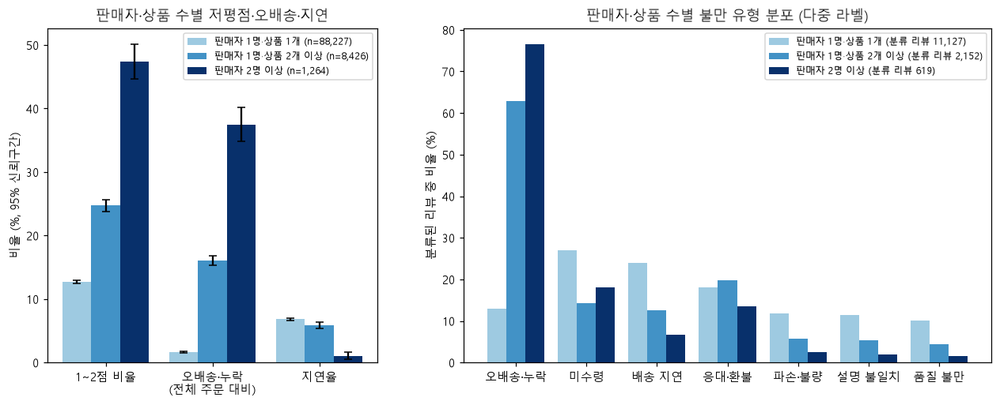

# Q4. 불만이 집중되는 판매자·카테고리·지역

- 단위: 리뷰가 있는 주문(주문당 대표 리뷰). 지연율만 배송 지표 대상 주문 기준
- **판매자 통제 가능 불만**: 오배송·누락, 파손·불량, 설명 불일치, 품질 불만, 응대·환불 중 하나라도 있는 주문 / **물류 불만**: 미수령·배송 지연이 있는 주문. 분모는 전체 주문
- 판매자 평가는 판매자가 1명인 주문(96,653건, 판매자 3,073명)만 사용
- 쿼리: `sql/analysis/q4_01` ~ `q4_05` / 노트북: `notebooks/06_q4_complaint_hotspots.ipynb` / 차트: `reports/figures/q4_*.png`

## 핵심 발견

### 1. 판매자 불만은 소수에 몰려 있지만, 대부분은 주문이 몰려 있어서다. 진짜 문제 판매자는 약 60명

| 집중도 | 상위 10% 판매자 | 상위 20% 판매자 | 지니 계수 |
|---|---|---|---|
| 판매자 통제 가능 불만 건수 | 74.1% | 87.9% | 0.85 |
| 주문 수 | 68.4% | 82.8% | 0.79 |

- 불만 건수 상위 10% 판매자(308명)가 판매자 통제 가능 불만의 74%를 차지하지만, 이들은 주문도 65%를 가지고 있다. 이들의 불만율은 9.4%로 전체 평균 8.2%와 크게 다르지 않다. 판매자의 55%는 이런 불만이 0건이다.
- **주문 수만큼의 불만이 아니라 평균보다 확실히 높은 불만율을 가진 판매자**를 찾으려고 베이지안 보정 후 기준을 적용했다. 기준은 주문 30건 이상, 보정 불만율이 전체 평균의 1.5배(12.3%) 이상이다.
- 이 기준에 맞는 **관리 대상 판매자는 60명(전체 판매자의 2%)**이다. 이들이 판매자 통제 가능 불만의 **17.1%(1,351건)**를 차지하고, 평균 불만율이었다면 생기지 않았을 **초과 불만이 778건**이다.

### 2. 불만 유형은 카테고리마다 뚜렷하게 다르다: 가구는 파손, 침구는 품질

전체 대비 lift(카테고리의 유형 비율 / 전체 비율) 1.5 이상이면서 해당 리뷰가 15건 이상인 경우:

| 카테고리 | 두드러진 유형 | 카테고리 비율 | 전체 비율 | lift | 리뷰 수 |
|---|---|---|---|---|---|
| furniture_living_room | 파손·불량 | 27.3% | 10.3% | 2.65 | 18 |
| office_furniture | 파손·불량 | 22.5% | 10.3% | 2.18 | 72 |
| bed_bath_table | **품질 불만** | 18.3% | 8.6% | 2.13 | **298** |
| home_appliances | 설명 불일치 | 21.0% | 9.9% | 2.13 | 21 |
| telephony | 파손·불량 / 설명 불일치 | 17.3% / 15.2% | 10.3% / 9.9% | 1.68 / 1.54 | 116 / 102 |
| (미분류) | 설명 불일치 | 18.0% | 9.9% | 1.83 | 47 |

- **가장 큰 카테고리인 bed_bath_table(주문 9,313건)의 품질 불만이 전체의 2.1배**로, 건수로도 가장 큰 개선 대상이다.
- 1~2점 비율이 가장 높은 카테고리는 office_furniture(22.6%), audio(21.9%), 카테고리 정보가 없는 상품(20.2%)이다. 카테고리가 비어 있는 상품은 설명 불일치가 1.8배다. **상품 정보가 부실한 상품에서 설명 불일치 불만이 많이 나타난다**는 점은 Q1 결과와 같은 방향이다.

### 3. 지역 차이는 판매자보다 고객 쪽 배송 지표와 함께 움직인다

- 고객 주별 지연율과 물류 불만 비율의 상관은 **0.90**(주문 300건 이상 21개 주)이다.
  - 지연율이 높은 주: AL 20.8%, MA 17.1%, SE 15.0%. 저평점 비율도 22~24%다.
  - 지연율이 낮은 주: SP 4.4%, PR 4.0%. 저평점 비율은 12%대다.
- **RJ는 리뷰 주문 12,687건, 지연율 11.9%, 1~2점 20.7%**다. 북동부 소형 주보다 비율은 낮지만 규모가 커서 지연 주문 수로는 가장 큰 개선 대상이다(Q2와 같은 결론).
- 판매자 주별로는 판매자 통제 가능 불만 비율이 6~10%로 비슷하다. 지역 간 차이는 판매자의 출고 품질보다 **고객 지역의 배송 지연**과 함께 나타난다.

### 4. 여러 판매자 주문 가설은 확인됐지만, 상당 부분은 "상품이 여러 개"인 주문에서도 함께 나타난다

| 그룹 | 주문 수 | 1~2점 비율 | 오배송·누락 (전체 주문 대비) | 기록상 지연율 |
|---|---|---|---|---|
| 판매자 1명·상품 1개 | 88,227 | 12.7% | 1.6% | 6.8% |
| 판매자 1명·상품 2개 이상 | 8,426 | 24.7% | 16.0% | 5.8% |
| 판매자 2명 이상 | 1,264 | **47.4%** | **37.5%** | **1.0%** |

자세한 검증 결과는 아래 "여러 판매자 주문 가설 검증" 절에 정리했다.

## 관리 대상 판매자 상위 10명

기준: 주문 30건 이상, 보정 불만율이 전체 평균(8.19%)의 1.5배 이상. 정렬: 초과 불만 건수(실제 불만 − 주문 수 × 전체 평균 불만율) 순

| # | seller_id | 주 | 주문 수 | 불만 건수 | 초과 불만 | 불만율 (보정 전 → 후) | 1~2점 (보정 후) | 지연율 | 주요 불만 유형 |
|---|---|---|---|---|---|---|---|---|---|
| 1 | 7c67e1448b00f6e969d365cea6b010ab | SP | 966 | 195 | 115.9 | 20.2% → 19.7% | 25.1% | 9.1% | 오배송·누락 (50%) |
| 2 | 2eb70248d66e0e3ef83659f71b244378 | SP | 196 | 87 | 70.9 | 44.4% → 38.7% | 46.3% | 11.0% | 설명 불일치 (37%) |
| 3 | 1ca7077d890b907f89be8c954a02686a | SP | 112 | 55 | 45.8 | 49.1% → 39.1% | 52.7% | 17.1% | 설명 불일치 (76%) |
| 4 | 1025f0e2d44d7041d6cf58b6550e0bfa | SP | 877 | 113 | 41.2 | 12.9% → 12.7% | 16.5% | 8.1% | 오배송·누락 (74%) |
| 5 | 897060da8b9a21f655304d50fd935913 | SP | 308 | 55 | 29.8 | 17.9% → 16.8% | 24.5% | 9.8% | 설명 불일치 (45%) |
| 6 | 710e3548e02bc1d2831dfc4f1b5b14d4 | PR | 133 | 38 | 27.1 | 28.6% → 24.2% | 29.4% | 3.1% | 오배송·누락 (66%) |
| 7 | 88460e8ebdecbfecb5f9601833981930 | PR | 228 | 41 | 22.3 | 18.0% → 16.6% | 27.4% | 18.1% | 파손·불량 (39%) |
| 8 | 7040e82f899a04d1b434b795a43b4617 | SP | 205 | 39 | 22.2 | 19.0% → 17.4% | 25.8% | 8.0% | 파손·불량 (51%) |
| 9 | 5dceca129747e92ff8ef7a997dc4f8ca | SP | 316 | 46 | 20.1 | 14.6% → 13.9% | 19.2% | 5.8% | 오배송·누락 (80%) |
| 10 | 229c3efbfb0ea2058de4ccdfbc3d784a | MG | 120 | 26 | 16.2 | 21.7% → 18.5% | 23.1% | 1.7% | 설명 불일치 (62%) |

- **상위 10명의 초과 불만 합계는 약 412건**으로, 관리 대상 60명 전체 초과 불만(778건)의 절반을 넘는다.
- 주요 불만 유형이 판매자마다 분명히 나뉘어서 판매자별 맞춤 조치가 가능하다. 오배송·누락은 출고 검수, 설명 불일치는 상품 정보 수정, 파손·불량은 포장 개선이 필요하다.
- 관리 대상 60명의 주요 유형은 오배송·누락 20명, 설명 불일치 14명, 응대·환불 12명, 품질 9명, 파손 5명이다.
- 보정 불만율과 보정 1~2점 비율의 상관이 0.83이라, 텍스트 불만 기준으로 고른 판매자가 평점 기준으로도 나쁘다.

## 여러 판매자 주문 가설 검증 (Q2 발견 5번)

Q2 회귀에서 판매자 수가 1명 늘 때 1~2점 오즈비가 4.6이었다. 원인이 "판매자가 여러 명"인지 "상품이 여러 개"인지 나누려고 **판매자 1명·상품 2개 이상** 주문을 비교군으로 두었다.

| 비교 | 1~2점 비율 차이 | 상대 비율 | 오배송·누락 차이 | 상대 비율 |
|---|---|---|---|---|
| 판매자 2명 이상 vs 판매자 1명·상품 1개 | **+34.7%p** (95% CI +31.9 ~ +37.4) | 3.73배 (3.51 ~ 3.96) | +35.9%p (+33.2 ~ +38.6) | 22.9배 |
| 판매자 1명·상품 2개 이상 vs 판매자 1명·상품 1개 | +12.0%p (+11.1 ~ +13.0) | 1.95배 (1.87 ~ 2.03) | +14.4%p (+13.6 ~ +15.2) | 9.8배 |
| 판매자 2명 이상 vs 판매자 1명·상품 2개 이상 | **+22.7%p** (+19.8 ~ +25.6) | 1.92배 (1.79 ~ 2.05) | +21.5%p (+18.7 ~ +24.3) | 2.3배 |

- **가설은 확인됐다.** 판매자가 여러 명인 주문의 저평점 비율(47.4%)은 상품이 1개인 주문의 3.7배다.
- **다만 일부는 "상품이 여러 개"인 주문에서도 나타난다.** 같은 판매자의 여러 상품 주문도 저평점이 1.95배다. 그 위에 판매자가 여러 명이면 다시 1.92배가 된다. 두 요인이 겹쳐 있다.
- **함께 나타난 불만은 대부분 일부 미도착(분할 배송)이다.** 분류된 리뷰 중 오배송·누락 비율이 판매자 1명·상품 1개 13%, 판매자 1명·상품 2개 이상 63%, 판매자 2명 이상 77%다. 대부분 "일부만 받았다"는 불만이다.
- **배송 데이터에는 이 문제가 보이지 않는다.** 판매자 2명 이상 주문의 기록상 지연율은 1.0%로 오히려 가장 낮다. 기록상 배송 기간도 9.2일로 판매자 1명 주문(12.6일)보다 짧다. **수령일이 먼저 도착한 일부 상품 기준으로 기록되는 것으로 보이며(가설)**, 늦게 오거나 오지 않은 상품의 문제는 리뷰 텍스트에만 남는다. 리뷰 분류가 운영 데이터의 빈틈을 보완한 사례다.

## 해석할 때 주의할 점

- **판매자는 판매자 1명 주문만으로 평가했다.** 여러 판매자 주문(1,264건)은 책임 판매자를 정할 수 없어 뺐다. 위에서 봤듯이 이 주문들은 불만이 가장 많은 집단이므로, 판매자별 불만율은 그만큼 낮게 잡혀 있을 수 있다.
- **베이지안 보정의 의미**
  - 전체 판매자의 불만율 분포를 사전분포(판매자 통제 가능 불만율 Beta(2.88, 33.16), 평균 8.0%, 약 36건 분량의 정보)로 놓고, 각 판매자의 관측값과 섞었다.
  - 주문이 적은 판매자는 평균 쪽으로 크게 당겨진다. 예를 들어 주문 41건에 불만율 34.1%인 판매자는 21.9%가 된다. 주문이 많으면 거의 그대로다(966건, 20.2% → 19.7%).
  - 순위의 우연성을 줄이려는 장치일 뿐 "진짜 불만율"을 알려 주지는 않는다. 사전분포가 모든 판매자에게 같다고 가정하므로, 카테고리처럼 판매자마다 다른 위험 요인은 반영하지 않는다.
- **판매자 불만에 물류 영향이 섞일 수 있다.** 판매자 통제 가능 유형에서 미수령·지연은 뺐지만, 응대·환불 불만은 배송 문제와 함께 나타나는 경우가 많다(Q1). 파손도 운송 중에 생길 수 있다. 관리 대상 판매자의 지연율(1.7~18.1%)도 함께 봐야 한다.
- **카테고리마다 기준선이 다르다.** 가구의 파손이나 침구의 품질처럼 상품 성격에서 오는 차이가 있으므로, 판매자를 비교할 때는 같은 카테고리 안에서 비교하는 것이 더 공정하다(이번 분석에서는 하지 않음).
- **불만 유형은 LLM 분류 결과다.** 검증 정확도(완전 일치율 0.78)와 유형별 한계(응대 과다 부여, 기타 과소 등)는 Q1 리포트를 참고한다.
- **관찰 데이터다.** 카테고리·지역·판매자 수와 불만의 관계는 연관이고, 카테고리 구성이나 가격대 같은 다른 요인이 섞여 있을 수 있다.

## 한계와 다음 단계

**한계: 비율 기준만으로 고르면 주문이 많은 판매자를 놓칠 수 있다.** 관리 대상은 보정 불만율(전체 평균의 1.5배 = 12.3% 이상) 기준으로만 골랐다. 그래서 불만율은 기준에 조금 못 미치지만 주문이 많아 초과 불만 건수가 큰 판매자가 빠졌다.

| 판매자 | 주문 수 | 초과 불만 | 보정 불만율 | 관리 대상 여부 |
|---|---|---|---|---|
| 6560211a | 1,807 | **68.0건** | 11.9% | 제외 (기준 12.3%에 조금 못 미침) |
| 4a3ca931 | 1,687 | **61.8건** | 11.8% | 제외 |
| (참고) 관리 대상 3위 1ca7077d | 112 | 45.8건 | 39.1% | 포함 |

- 위 두 판매자는 초과 불만이 관리 대상 3위(45.8건)보다 많다.
- 관리 대상 10위(16.2건)보다 초과 불만이 많은데 관리 대상에서 빠진 판매자가 **7명**이다.

**다음 단계**: 관리 대상 기준에 보정 불만율과 함께 **초과 불만 건수 기준**(예: 초과 불만이 일정 건수 이상이면 비율과 관계없이 포함)을 쓰는 방안을 검토한다. 이번 분석과 Q5의 개선 효과 추정은 기존 기준(보정 불만율 기준 60명)을 그대로 유지한다.
