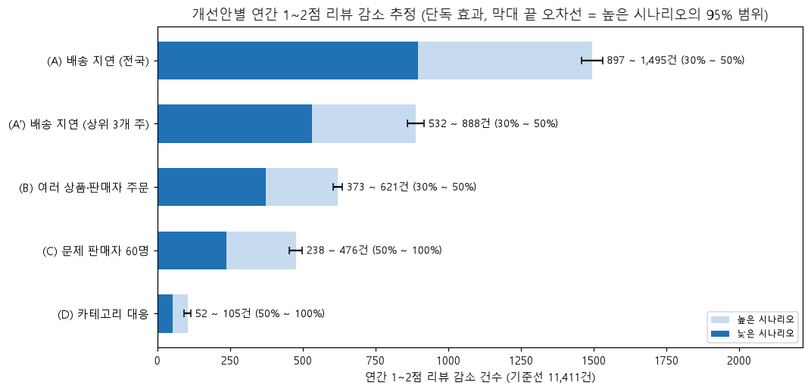
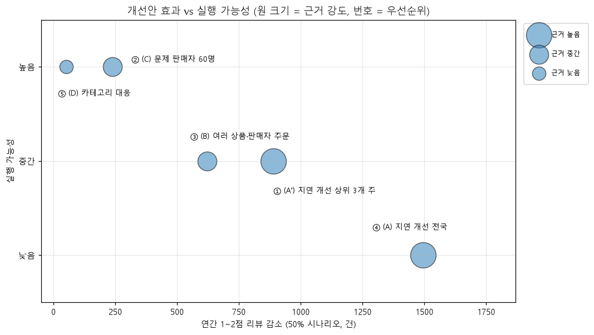

# Q5. 어떤 개선 조치가 가장 큰 효과를 낼 것인가?

## 경영진 요약

- **배송 지연이 가장 큰 개선 지점입니다.** 지연 주문의 절반을 제때 도착시키면 1~2점 리뷰가 연간 약 **1,500건(13%)** 줄어듭니다. 지연 주문의 59%가 몰린 **SP·RJ·MG 3개 주에만 집중해도 약 890건(8%)**을 얻을 수 있습니다.
- **즉시 실행할 수 있는 조치**는 불만율이 평균의 2.4배인 **문제 판매자 60명 관리**입니다. 연 240~480건 감소가 예상되고, 개선 주문 1건당 효과가 가장 큽니다.
- 그다음은 **여러 상품·여러 판매자 주문의 분할 배송 개선**(연 약 620건)입니다.
- 추천 묶음(3개 주 지연 개선 + 판매자 60명 관리 + 분할 배송 개선 + 카테고리 대응, 각 50% 달성)으로 1~2점 리뷰가 연간 약 **1,770건(15.5%)** 줄어듭니다. 지연 개선을 전국으로 넓히면 약 **2,370건(20.8%)**까지 커집니다(중복 제거 후).
- 재구매 증가 효과는 연 10명 안팎으로 미미합니다. 이 개선안들의 목표는 **재구매 증대가 아니라 평점과 불만 감소**로 잡아야 합니다.

## 우선순위

연간 1~2점 감소는 각 개선안을 단독으로 적용했을 때의 50% 시나리오 평균값입니다. 기준선은 연간 1~2점 리뷰 11,411건입니다.

| 순위 | 개선안 | 연간 1~2점 감소 | 기준선 대비 | 개선 주체 | 실행 가능성 | 근거 강도 | 이유 |
|---|---|---|---|---|---|---|---|
| 1 | (A') 배송 지연 개선: SP·RJ·MG 집중 | **888건** | 7.8% | 물류 (플랫폼·물류 파트너) | 중간: 3개 주의 운송사·경로 관리로 범위가 좁혀짐 | 높음: Q2 오즈비 17, 지연 일수에 따른 단계적 증가, 월별 상관 0.74 | 실행 가능한 범위에서 효과가 가장 크고 근거가 가장 강함 |
| 2 | (C) 문제 판매자 60명 관리 | 238건 (100%: 476건) | 2.1% | 플랫폼 판매자 관리팀 + 해당 판매자 | 높음: 대상이 명확하고 판매자마다 주요 불만 유형이 분명함 | 중간: 베이지안 보정으로 순위를 안정화했지만 불만을 저평점으로 바꾸는 데 가정이 들어감 | 비용이 낮은 빠른 성과, 개선 주문당 효과(0.75건)가 가장 큼 |
| 3 | (B) 여러 상품·여러 판매자 주문 | 621건 | 5.4% | 플랫폼 (주문·출고 시스템) + 판매자 | 중간: 묶음 출고, 부분 배송 안내 등 시스템 변경이 필요 | 중간: 차이가 크고 신뢰구간이 좁지만 상품 수 자체의 영향, 고객 특성과 섞여 있음 | 효과는 지연 개선 다음으로 크지만 실행 비용과 근거 불확실성이 있음 |
| 4 | (A) 배송 지연 개선: 전국 | 1,495건 | 13.1% | 물류 | 낮음: 전국 물류망 개선은 장기 과제 | 높음 | 효과는 가장 크지만 (A')의 확장 단계로 둠 |
| 5 | (D) 카테고리 대응 | 52건 (100%: 105건) | 0.5% | 판매자 + 플랫폼 상품 정책 | 높음: 카테고리 필수 입력, 포장 기준 등 정책으로 실행 가능 | 낮음: 카테고리별 표본이 작음(초과 불만 168건) | 쉽지만 효과가 작아 판매자 관리와 함께 진행 |
| 보완 | (E) 배송 문제 선제 안내 | 추정 안 함 | - | 플랫폼 (알림 시스템) | 높음: 자동 알림 | 낮음: 동시 출현 패턴만 있음 | 줄일 수 있는 응대 불만 최대 818건. (A')·(B)와 함께 저비용으로 진행 |

## 기준과 추정 방법

- **기준 기간**: 데이터 수집 종료일(2018-08-29) 이전 12개월(2017-08-30 ~ 2018-08-29)에 구매한 주문 중 리뷰가 있는 주문 **75,874건**. 이 기간 1~2점 리뷰 **11,411건(15.0%)**을 연간 기준선으로 쓴다.
- **공통 틀**: 개선안마다 대상 주문을 정하고, 그중 일정 비율을 "개선"한다. 개선된 주문의 1~2점 확률은 반사실 수준으로 내려간다고 본다. 어떤 주문이 개선될지 무작위로 고르는 과정을 500번 반복해 평균과 95% 범위를 낸다.
- **반사실 수준 p_nocomp**: 불만 라벨이 없는 주문(분류 대상이 아니거나 불만 없음)의 1~2점 비율은 **4.6%**다. 판매자·카테고리 불만이 사라진 주문은 이 수준이 된다고 가정한다. 참고로 판매자 통제 가능 불만이 있는 주문의 1~2점 비율은 79.4%다.

## 개선안별 근거, 방법, 효과

### (A) 배송 지연 개선

- **근거**: Q2에서 지연은 다른 요인을 통제해도 1~2점 오즈를 17배 높였다. 지연이 길수록 효과가 커지고(1~3일 5배 → 8~14일 44배), 물류 불만 비중과 실제 지연율의 월별 상관이 0.74였다. Q4에서 고객 주별 지연율과 물류 불만의 상관은 0.90이었다.
- **방법**: Q2 모형 1(오즈비 17.2)을 다시 적합했다. 기준 기간의 지연 주문 5,610건마다 "지연일 때"와 "제때일 때"의 예측 1~2점 확률을 계산하고, 그 차이를 감소량으로 썼다(주문당 평균 0.53).
- **효과**

| 시나리오 | 개선 주문 | 연간 1~2점 감소 (95% 범위) | 기준선 대비 |
|---|---|---|---|
| 전국 30% | 1,683 | 897 (863 ~ 933) | 7.9% |
| 전국 50% | 2,805 | **1,495** (1,458 ~ 1,531) | 13.1% |
| SP·RJ·MG 30% | 999 | 532 (503 ~ 563) | 4.7% |
| SP·RJ·MG 50% | 1,664 | **888** (860 ~ 918) | 7.8% |

- **줄어드는 불만 유형 (전국 50%)**: 미수령 809건, 배송 지연 699건, 응대·환불 277건. 늦은 주문의 리뷰는 수령 전에 쓰여 미수령 불만이 되는 경우가 많기 때문이다(Q2).
- **SP·RJ·MG 3개 주**에 지연 주문의 59%(SP 1,521건, RJ 1,357건, MG 463건)가 있다. 3개 주에 집중해도 전국 효과의 59%를 얻는다. 비율로 보면 북동부 주(AL, MA)의 지연율이 더 높지만, 건수로는 이 3개 주가 압도적이다.

### (B) 여러 상품·여러 판매자 주문

- **근거**: Q4에서 판매자 2명 이상 주문의 1~2점 비율은 판매자 1명·상품 1개 주문의 3.7배였다. 같은 판매자의 여러 상품 주문도 1.95배였다. 불만의 대부분은 "일부만 받음"(오배송·누락)이었고, 기록상 배송 데이터에는 이 문제가 나타나지 않았다.
- **방법**: 기준 기간 그룹별 1~2점 비율과 기준 그룹의 차이를 감소량으로 썼다. 판매자 1명·상품 1개 13.0%, 판매자 1명·상품 2개 이상 26.3%(감소량 0.133), 판매자 2명 이상 49.7%(감소량 0.367)다. 대상 7,492건 중 30%·50%를 기준 수준으로 바꾸는 것은 격차를 30%·50% 좁히는 것과 같다.
- **효과**: 30%에서 373건(3.3%), **50%에서 621건(5.4%)**. 오배송·누락 불만은 약 720건 줄어든다(50%).
- **실행 예시**: 같은 주문의 상품을 묶어 출고하기, 분할 배송일 때 "나머지 상품 도착 예정일" 안내, 여러 판매자 주문의 도착 예정일 통합 표시.

### (C) 문제 판매자 60명 관리

- **근거**: Q4에서 베타-이항 베이지안 보정 후 주문 30건 이상이면서 판매자 통제 가능 불만율이 평균의 1.5배 이상인 판매자 60명을 골랐다. 이들이 해당 불만의 17.1%를 차지했다.
- **방법**: 기준 기간에 이 60명의 주문은 5,398건이고 불만율은 20.1%다(판매자 1명 주문 평균 8.3%). 평균보다 많은 초과 불만 638건 중 50%·100%를 없앤다. 불만이 사라진 주문의 감소량은 0.747(79.4% − 4.6%)이다.
- **효과**: **50%에서 238건(2.1%)**, 100%(평균 수준까지)에서 476건(4.2%). 50%일 때 줄어드는 불만 유형은 오배송·누락 131건, 응대·환불 91건, 설명 불일치 77건, 파손·불량 61건, 품질 불만 40건이다.
- **실행 예시**: 판매자별 주요 불만 유형에 맞춘 조치. 오배송·누락은 출고 검수, 설명 불일치는 상품 정보 수정, 파손은 포장 기준. Q4 리포트의 관리 대상 판매자 목록과 주요 유형을 그대로 쓸 수 있다.

### (D) 카테고리 대응

- **근거**: Q4의 카테고리별 두드러진 불만 유형(전체 대비 lift 1.5 이상).
- **방법**: 카테고리의 유형 비율이 기준 기간 평균보다 높은 만큼(초과분)을 50%·100% 없앤다.

| 세부 | 초과 불만 | 연간 1~2점 감소 (50% / 100%) |
|---|---|---|
| D1 bed_bath_table 품질 불만 (16.5% vs 평균 8.1%) | 109건 | 32 / 64 |
| D2 가구 파손·불량 (office_furniture, furniture_living_room 등) | 33건 | 12 / 23 |
| D3 카테고리 미입력 상품 설명 불일치 (22.7% vs 9.8%) | 26건 | 9 / 18 |
| 합계 | 168건 | **52 / 105** |

- 기준 기간 1년으로 보면 건수가 작다. 카테고리 미입력 상품의 카테고리 필수 입력처럼 실행이 쉬운 조치만 판매자 관리와 함께 진행하는 것을 권한다.

### (E) 배송 문제 선제 안내 (효과 추정 안 함)

- **근거**: Q1에서 응대·환불 불만의 27%는 미수령, 24%는 지연과 함께 나타났다. 배송 실패 뒤의 안내 부재가 2차 불만을 만드는 패턴이다.
- **규모**: 기준 기간 응대·환불 불만 2,150건 중 **미수령·지연과 함께 나온 818건(38%)**이 선제 안내로 줄일 수 있는 최대치다. 오배송·누락(분할 배송)과 함께 나온 493건도 부분 배송 안내로 줄일 여지가 있다.
- 1~2점 감소는 추정하지 않았다. 안내가 불만을 줄인다는 직접 근거가 없기 때문이다. 자동 알림은 비용이 낮으므로 (A')·(B)와 함께 시험(A/B 테스트)해서 효과를 측정하는 것을 권한다.

### (F) 재구매 파급 효과

- **방법**: 겹침 제거 후 줄어드는 1~2점 리뷰 중 첫 주문에 해당하는 건수에 Q3의 재구매율 차이(1~2점 vs 4~5점, 0.44%p)를 곱했다.
- **효과**: 추천 묶음은 첫 주문 1~2점이 1,706건 줄고 **재구매 고객은 연 약 7.5명** 늘어난다. 모두 50%인 기준 묶음은 첫 주문 2,289건, **연 약 10명**이다.
- 재구매 기저율(2%)과 효과 크기가 모두 작아서, 이 개선안들의 재구매 효과는 사업적으로 의미 있는 규모가 아니다. 재구매를 늘리려면 별도 전략(재구매 쿠폰, 추천 등)이 필요하다.

## 겹침 제거 후 전체 효과

같은 주문이 여러 개선안의 대상인 경우가 891건 있다(가장 많은 겹침은 지연 주문 중 여러 상품 주문 428건). 겹치는 주문은 **가장 큰 감소 하나만 인정**했다(보수적 기준).

| 묶음 시나리오 | 단순 합 | 겹침 제거 후 (95% 범위) | 기준선 대비 | 재구매 고객 증가 |
|---|---|---|---|---|
| 하한 (A·B 30%, C·D 50%) | 1,562 | 1,541 (1,497 ~ 1,585) | 13.5% | 6.6명 |
| **추천 묶음** (A' 3개 주 + B + C + D, 모두 50%) | 1,800 | **1,774** (1,737 ~ 1,814) | **15.5%** | 7.5명 |
| 기준 (A 전국 + B + C + D, 모두 50%) | 2,406 | 2,370 (2,324 ~ 2,416) | 20.8% | 10.1명 |
| 상한 (A·B 50%, C·D 100%) | 2,696 | 2,628 (2,579 ~ 2,675) | 23.0% | 11.2명 |

개선안들이 대체로 서로 다른 주문을 대상으로 해서, 겹침을 제거해도 단순 합과의 차이가 1~3%로 작다.

## 해석할 때 주의할 점

- **관찰 데이터 기반 추정이라 인과 효과를 보장하지 않는다.** "지연 주문을 제때 도착시키면 1~2점 확률이 모형이 예측한 만큼 내려간다"는 가정이다.
  - Q2 모형이 통제하지 못한 요인(판매자 품질, 상품, 가격)이 지연과 함께 움직였다면 (A)의 효과는 과대 추정이다.
  - (B)의 그룹 차이에도 여러 상품을 사는 고객의 특성이 섞여 있을 수 있다.
- **시나리오 가정**
  - 30%·50%·100%는 목표 수준의 가정이지 달성 가능성을 보증하는 값이 아니다. 개선에 드는 비용도 추정하지 않았다.
  - 개선된 주문은 반사실 그룹(제때 도착한 주문, 판매자 1명·상품 1개 주문, 불만 없는 주문)처럼 행동한다고 가정했다.
  - (C)(D)는 한 주문에 불만이 여러 개 있어도 해당 불만을 없애면 불만 없는 주문 수준(4.6%)이 된다고 봐서 과대 추정일 수 있다.
  - 효과 범위(95%)는 어떤 주문이 개선될지의 무작위성만 반영한다. 모형 계수의 불확실성은 포함하지 않았다.
- **LLM 분류 오차가 건수에 미치는 영향** (검증 기준 완전 일치율 0.78)
  - (C)(D)의 불만 건수와 (E)의 응대 불만 건수는 LLM 라벨로 센 값이다.
  - 응대·환불은 요청만 있어도 붙는 경향이 있어(정밀도 0.83) (E)의 818건은 과대일 수 있다.
  - 미수령은 과소 추정 경향이 있어(재현율 0.67) (A)의 미수령 감소 건수는 과소일 수 있다.
  - (A)(B)의 1~2점 감소는 LLM 라벨이 아니라 평점으로 계산해서 분류 오차의 영향을 받지 않는다.
- **효과 지표의 범위**: 리뷰가 있는 주문의 1~2점 리뷰 수만 셌다. 리뷰를 남기지 않은 고객의 불만족, 4~5점 안에서의 개선은 포함하지 않는다. 1년치 데이터라 성장이나 계절성은 반영하지 않았다.
- **겹침 제거 기준**: "가장 큰 감소 하나만 인정"은 보수적 기준이다. 두 문제가 함께 있던 주문은 둘 다 고치면 더 좋아질 수 있으므로, 실제 묶음 효과는 표의 값과 단순 합 사이에 있을 가능성이 높다.

## 출처

- 노트북: `notebooks/07_q5_recommendations.ipynb` / 쿼리: `sql/analysis/q5_01_order_base.sql`(기준 기간 데이터), `q2_08`(지연 모형), `q4_01`(판매자 보정)
- 근거 리포트: `q1_complaint_causes.md`, `q2_delivery_delay.md`, `q3_first_order_repurchase.md`, `q4_complaint_hotspots.md`
