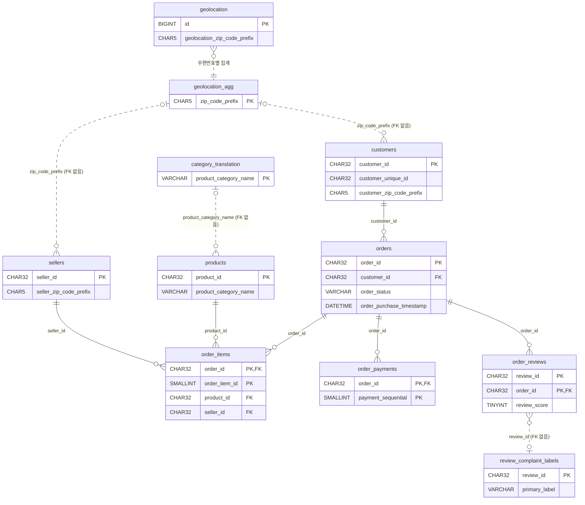

# sql/schema

MySQL 8.0 스키마. `01_create_tables.sql`을 `src/etl/create_schema.py`로 실행한다(`--reset`은 역순으로 지우고 다시 생성).

## 테이블 관계

실선은 FK가 걸린 관계, 점선은 FK 없이 인덱스로만 조인하는 관계.

## 설계 결정

설계 가정은 원본 CSV로 확인했다(2026-10-05, data/raw 읽기 전용).

- **조합키**
  - `order_items (order_id, order_item_id)`, `order_payments (order_id, payment_sequential)`: 주문 1건에 여러 행이 있고 조합이 고유하다.
  - `order_reviews (review_id, order_id)`: `review_id` 단독으로는 고유하지 않다(99,224행 중 고유 98,410개, 한 리뷰가 여러 주문에 연결). `order_id`도 단독으로는 고유하지 않다. 둘의 조합은 고유하다.
- **우편번호 CHAR(5)**: 숫자로 읽으면 앞자리 0이 사라진다(customers 23,995행, sellers 1,027행, geolocation 245,733행). 원본은 모두 5자리 숫자 문자열이라 문자로 저장한다. 적재 시에도 문자열로 읽어야 한다.
- **geolocation_agg**: 원본 `geolocation`은 우편번호당 여러 행(100만 행, 고유 우편번호 19,015개)이라 고객·판매자와 바로 조인하면 행이 불어난다. 우편번호당 1행(평균 위경도, 최빈 city·state)으로 요약해 조인에 쓴다. 원본에는 브라질 밖 좌표(위도 최대 45, 경도 최대 121)가 섞여 있으므로, 집계할 때 브라질 범위 밖 좌표를 제외하는 것을 권장한다(적재 단계에서 결정).
- **FK를 걸지 않은 관계**
  - `products → category_translation`: 번역표에 없는 카테고리 2개(`portateis_cozinha_e_preparadores_de_alimentos` 10행, `pc_gamer` 3행)와 빈 카테고리 610행이 있다. 빈 카테고리는 NULL로 적재하고, 분석 시 LEFT JOIN한다.
  - `customers`·`sellers → geolocation_agg`: 고객 우편번호 157개(278행), 판매자 우편번호 7개(7행)가 위경도 데이터에 없다.
  - `review_complaint_labels → order_reviews`: 분류 대상은 `review_id` 기준으로 중복을 제거했으므로 `order_reviews`의 조합키와 맞지 않는다. `review_id`로 조인하면 한 리뷰가 여러 주문에 연결된 경우 행이 늘어나므로 집계 기준(리뷰 단위/주문 단위)을 정하고 조인한다.
- **FK를 건 관계**: orders→customers, order_items→orders·products·sellers, order_payments→orders, order_reviews→orders. 6개 모두 자식 값 중 부모에 없는 값이 0건이다. 반대로 부모에 자식이 없는 경우는 있다(아이템 없는 주문 775건, 결제 없는 주문 1건, 리뷰 없는 주문 768건).
- **타입**: ID는 CHAR(32)(원본이 모두 32자), 금액은 DECIMAL(10,2)(최대 13,664.08, 소수 2자리), 날짜는 DATETIME, 리뷰 텍스트는 TEXT, 위경도는 DOUBLE(원본 소수 최대 20자리).
- **이름과 문자 집합**: 테이블 이름은 원본 파일명에서 `olist_`·`_dataset`을 뺀 snake_case, 컬럼 이름은 원본 그대로(오타 `product_name_lenght` 포함). 콜레이션은 지정하지 않고 DB 기본값(`utf8mb4_0900_ai_ci`)을 따른다.
- **적재 시 주의**: `product_category_name_translation.csv`는 UTF-8 BOM이 있어 `utf-8-sig`로 읽어야 한다. 빈 날짜(`order_approved_at` 160건, `order_delivered_carrier_date` 1,783건, `order_delivered_customer_date` 2,965건)와 products 숫자 컬럼 빈칸은 NULL로 적재한다.
